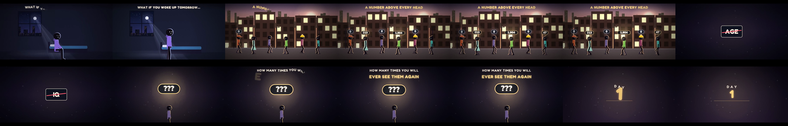
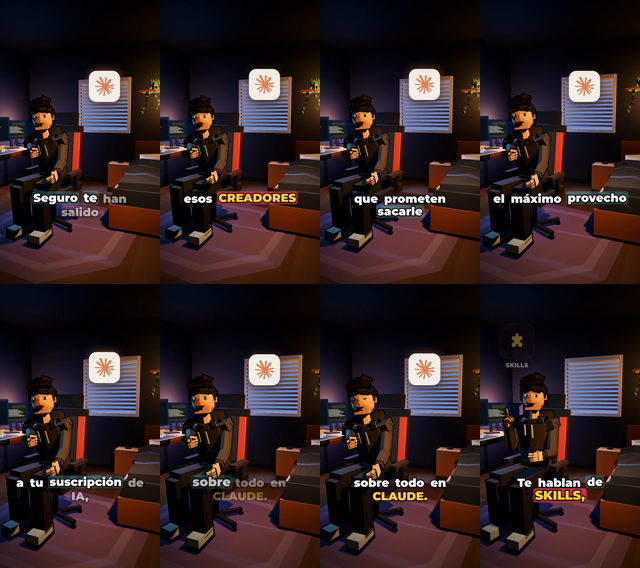

# Diagnóstico del canal: gancho, herramientas y qué adoptar sin hacer ruido

Fecha: 2026-11-10. Estado: **diagnóstico escrito, nada implementado**. Este documento no cambia el
estilo, no instala nada y no autoriza gasto. Lo que se adopte pasa por `memoria/decisiones.md`.

Pedido de Mario: «un diagnóstico para el canal sobre las siguientes herramientas/tips y ver qué
podemos implementar para mejorar el sistema sin hacer ruido en exceso». Respuestas de Mario a las
dudas del diagnóstico: los reels se descargan y se analizan con ffmpeg; el gancho debe ser **las
dos cosas** (situación del espectador en la primera frase **y** sostenida 5-8 s); **solo el
diagnóstico escrito** por ahora; el repo de terceros **solo como referencia, sin copiar código**.

---

## 1. Material analizado

| # | Fuente | Cómo se ha leído | Qué es |
|---|---|---|---|
| A | [Tuit de @dopamine_crypto](https://x.com/dopamine_crypto/status/2118644566987526434) | WebFetch (texto en coreano) | Recomienda el repo `Jakeschincariol/youtube-agent-skill` |
| B | [github.com/Jakeschincariol/youtube-agent-skill](https://github.com/Jakeschincariol/youtube-agent-skill) | README, `hooks.json` y `hookscore.py` leídos enteros | 11 skills de Claude + 6 scripts Python, MIT |
| C | [Reel DfgwuIqsFS0](https://www.instagram.com/reels/DfgwuIqsFS0/) | Descargado con yt-dlp 2026.08.19; ffprobe + hojas de contactos + detección de cortes | «Suppose So»: 410,1 s, 1280×720, 24 fps, 2,1 M me gusta |
| D | [Reel DfUHBKCJF8c](https://www.instagram.com/reels/DfUHBKCJF8c/) | Igual que C | «Cuarto 404»: 43,8 s, 720×1280, 30 fps, 20 k me gusta |

Los MP4 y los fotogramas quedan en `.runtime/diagnostico-hooks/reels/` (ignorado por git).

**Límite honesto de C y D:** no hay subtítulos automáticos ni he podido oír el audio (sí he medido
su volumen). El guion se reconstruye desde **los rótulos en pantalla**, que en los dos reels
transcriben la voz palabra a palabra. Es una lectura fiable del texto, no una transcripción
literal, y no cubre matices de entonación.

---

## 2. El gancho: qué hacen los dos reels

### Reel C — «Suppose So» (el que Mario quiere tomar como referencia)

**Los primeros 10 segundos, medidos:**

| Tiempo | Qué pasa en pantalla |
|---|---|
| 0,0 s | Pantalla casi negra; un personaje minúsculo sentado. Empieza a escribirse «WHAT IF YOU WOKE UP TOMORROW…» palabra a palabra. **Entrada desde negro**, no desde un logo ni un titular. |
| ~1,8 s | Corte a la calle de noche: la gente pasea y sobre cada cabeza aparece un número. Rótulo: «A NUMBER ABOVE EVERY HEAD». |
| ~5,5 s | Corte a negro: una caja de etiqueta «AGE» se escribe, se tacha con una raya roja y se descarta. Luego «IQ», tachado también. |
| ~7,5 s | «HOW MANY TIMES YOU WILL EVER SEE THEM AGAIN» con una píldora «???» en el centro. |
| ~12,3 s | «DAY 1» y se abre la primera escena concreta: el compañero de piso haciendo tostadas. |

**Anatomía del gancho, en cinco piezas:**

1. **Una situación del espectador, no un tema.** «What if you woke up tomorrow and above every
   head there was a number» es una hipótesis que el espectador se aplica a sí mismo en el segundo
   uno. No dice «hoy hablamos de la mortalidad» ni nombra a nadie.
2. **Una pregunta abierta que no se cierra.** El número no se explica hasta el segundo 7,5, y
   cuando llega la explicación, la pregunta sigue abierta: «¿cuántas veces vas a verlos?».
3. **La primera frase se escribe en pantalla palabra a palabra** (0-1,8 s). Se lee mientras se
   dice; a quien mira sin sonido le llega igual.
4. **El dato concreto llega en el segundo 12, no antes.** Los dos primeros elementos (la calle con
   números y las etiquetas tachadas) son **escenas**, no cifras. El primer número de verdad
   («23») aparece más tarde.
5. **La promesa se paga con un caso real y pequeño:** el compañero de piso, el jefe, la madre, el
   abuelo. Cada caso es una habitación, un objeto y un número. Nada de infografías abstractas.

**Después del gancho, el mismo patrón se repite:** el reel dura 410 s y solo tiene **12 cortes en
30 s** (uno cada 2,5 s de media) pero cada corte cambia de escena, no de dato. El ritmo no viene de
la cantidad de cosas en pantalla, viene de que cada 2-4 s hay **una escena nueva con un número
nuevo**. Es exactamente el ritmo que ya pide `docs/estilo.md` («algo nuevo cada 2-4 s»), pero
aplicado a escenas con significado, no a elementos decorativos.

**El cierre:** «Whose number would you be scared to see?» → «What will you do about it today?» →
botón «CALL» → «GO CALL THEM.» Hay una llamada emocional y luego una acción concreta. No hay
«suscríbete».

### Reel D — «Cuarto 404» (el que Mario dice que «no es exactamente»)

**Los primeros 6 segundos:** un único plano fijo (habitación 3D, personaje sentado, logo de Claude
en pantalla) con la frase «Seguro te han salido esos CREADORES que prometen sacarte el máximo
provecho a tu suscripción de IA, sobre todo en CLAUDE.» — **14 palabras de introducción antes de
que pase nada en pantalla.** Solo en el segundo ~6 aparecen los iconos SKILLS / PLUGINS / MCPs.

**Por qué no es el modelo:** el gancho es una **queja genérica** («seguro te han salido…») que
cualquiera podría decir de cualquier tema; no hay situación concreta del espectador, no hay
pregunta abierta y no hay escena. La primera escena real (WhatsApp → Discord → web → GitHub) no
llega hasta el segundo ~23, y el reel solo tiene **4 cortes en 44 s**.

**Lo que sí vale de D:** el cierre es una instrucción operativa clara («GUARDA EL VÍDEO», «los
links están abajo», «revisa la descripción o el comentario fijado»). Útil para shorts de
utilidad, no para noticias.

### Comparación con lo que hacemos hoy

Ganchos de los últimos guiones del canal:

| Vídeo | Primera frase del short |
|---|---|
| mithril-ia-medicina | «Una sola persona. Once laboratorios. Y una IA de mano derecha.» (gancho de cifras, sin sujeto: el espectador no aparece) |
| anthropic-fable-5-2 | «Anthropic ha sacado un modelo nuevo, Fable 5.2, y cuesta el doble por token que el que te recomienda usar.» |
| ventanas-contexto-ia (A) | «¿Sabías que tu IA relee todo cada vez que le escribes?» |
| resumen-semana-agentes (A) | «¿Cómo robaron 6.340 millones a Binance con una oferta de trabajo?» |

**El diagnóstico es claro:** nuestros ganchos empiezan por **el sujeto** (Anthropic, Binance, la
IA) o por **una cifra sin dueño** (una persona, once laboratorios), y el espectador entra como
observador. El de «Suppose So» empieza por **el espectador** y el sujeto (el número, el tiempo) es
lo que le pasa a él. La diferencia no es de tono ni de estilo visual: es de **quién es el
protagonista de la primera frase**.

Y hay un segundo detalle: en nuestros ganchos el dato llega en la primera frase; en «Suppose So»
el dato llega en el segundo 12. Esa demora es lo que hace que el espectador se quede: primero
entiende la situación, luego recibe la cifra que la vuelve interesante.

**Cuidado con el límite de esta comparación:** en un short de 45-90 s no siempre hay sitio para
demorar el dato 12 s. En «Suppose So» el gancho dura 12 s porque el vídeo dura 410 s. En nuestro
formato, el equivalente es: **gancho de 5-8 s sin cifras, y el primer dato justo después** — que
es lo que Mario ha pedido («las dos cosas»).

---

## 3. El repo `youtube-agent-skill`: qué hay dentro y qué nos sirve

### Lo que dice el autor (importante para no sobrevalorarlo)

- `hookscore.py` es **heurística, no predictor**: se calibró con 74 ganchos reales (primeros 15 s de
  subtítulos automáticos, top-8 y bottom-8 por visitas de cinco canales). Separa bien ganchos malos
  de reales, pero **casi no separa los aciertos de un creador de sus propios fallos**. Un score
  bajo es motivo para releer; un score alto no promete nada.
- Las fórmulas están calibradas **en inglés**.
- «Nada se publica hasta que tú lo haces»: las skills escriben, no suben.
- «Las etiquetas apenas importan»: el pack lo dice en vez de vender un generador de etiquetas.

### Las 11 skills, evaluadas contra nuestro flujo

| Skill | Qué hace | Veredicto | Por qué |
|---|---|---|---|
| `/yt-script` | 21 fórmulas de gancho + score del gancho | **Adoptar adaptado** | Es justo lo que pide Mario, pero en español y con nuestro criterio |
| `/yt-retention` | Lee el CSV de retención de YouTube Studio y dice el segundo exacto donde se van | **Adoptar adaptado** | Es la única pieza que nos da datos reales que hoy no tenemos; ver §4 |
| `/yt-package` | Título y miniatura como un par, con linter de truncado/duplicación/vaguedad | **Adoptar a medias** | El linter de título sí; la miniatura no, porque hoy no hacemos miniaturas |
| `/yt-audit` | Auditoría del canal que termina en **una** corrección, no veinte | **Adoptar la idea** | «Una corrección por vuelta» encaja con nuestro ritmo sin ruido |
| `/yt-seo` | Descripción, etiquetas y tres búsquedas a ganar | **No ahora** | Nuestras descripciones son mínimas por decisión de Mario (2026-11-02) |
| `/yt-chapters` | Capítulos validados con las reglas de YouTube | **No ahora** | El largo no los usa; puede ser un añadido barato más adelante |
| `/yt-comment` | Triaje de comentarios y respuestas en la voz del canal | **No ahora** | No hay volumen de comentarios que lo justifique |
| `/yt-plan` | Semana de publicaciones según horas reales | **No** | La cadencia la decide Mario |
| `/yt-viral` | Qué funciona en el nicho, ordenado por múltiplo sobre la mediana del canal | **No ahora** | Requiere recolección de datos de terceros; más ruido que valor |
| `/yt-shorts` | Saca shorts de un largo | **Descartar** | Choca con la regla de oro: **guion propio, nunca recortar uno del otro** |
| `/yt-edit` | Lista de cortes desde una transcripción | **Descartar** | No editamos crudos |

### Los 6 scripts Python, evaluados

| Script | Qué hace | Veredicto |
|---|---|---|
| `hookscore.py` | 5 propiedades (especificidad, dirección al espectador, apuesta, curiosidad, brevedad) y un veredicto que pesa 40 % la propiedad más débil | **Adoptar la idea, no el código** |
| `title.py` | Linter de título + miniatura | Adoptar solo la parte del título |
| `retention.py` | Lee el CSV de retención | Adoptar adaptado |
| `chapters.py`, `deadair.py`, `swipe.py` | Capítulos, cortes, nicho | No |

**Por qué no copiar el código:** está en inglés, con listas de palabras en inglés (`VAGUE`,
`STAKE`, `CURIOSITY`), y sus heurísticas no conocen nuestras reglas (MISTA, la caja de diálogo, el
cierre sin llamada a la acción, el enlace al largo). Copiarlo daría un resultado en inglés
disfrazado. Lo que sí vale es **la idea de fondo**, que se puede reescribir en español en menos de
100 líneas cuando toque.

### La idea que merece la pena llevarse: el «eslabón más débil»

El veredicto del repo no es la media de las cinco propiedades: es **60 % media + 40 % la más
débil**. La razón que da el autor es buena: un gancho con cuatro propiedades fuertes y una muerta
pierde por la muerta, y la media lo esconde. Es la misma lógica que ya aplica nuestro
`critico-visual`, que caza lo que las medidas no ven. Aplicado a un guion: un gancho con una
situación potente pero sin pregunta abierta es un gancho que pierde.

---

## 4. Lo que nos falta de verdad (más allá de las referencias)

| Falta | Por qué importa | Coste de tenerlo |
|---|---|---|
| **Datos de retención reales** | Hoy decimos «el gancho funciona» sin saber si el espectador se va en el segundo 3 o en el 20. Es la única fuente de verdad sobre el gancho. | Cero: el CSV de retención de Studio se descarga gratis. Solo hace falta que Mario lo exporte de un vídeo. |
| **Regla de gancho escrita** | El gancho se decide hoy en cada guion, sin criterio explícito. Por eso cada vídeo arranca distinto. | Escribir 5-6 líneas en `docs/estilo.md` y `docs/criterios.md`. |
| **Miniaturas** | La miniatura es la mitad del clic, y hoy no hacemos ninguna. `/yt-package` no sirve sin ella. | Diseño y decisión de estilo; no es de este diagnóstico. |
| **Medida del gancho antes de la PUERTA 1** | Hoy el gancho se aprueba a ojo de Mario. Una comprobación sistemática lo haría más rápido de revisar. | Un script pequeño, cuando se decida. |

---

## 5. Propuesta: qué implementar y en qué orden

Ordenado de menos a más ruido. **Nada de esto está hecho**; cada fila espera el sí de Mario.

### Fase 0 · Sin tocar código (lo que menos ruido hace)

| # | Qué | Dónde | Esfuerzo |
|---|---|---|---|
| 0.1 | **Regla de gancho en el estilo**: la primera frase de cada short y de cada largo es una situación del espectador, no el sujeto de la noticia; se sostiene 5-8 s antes del primer dato; la primera frase se escribe en pantalla palabra a palabra en los primeros 2 s. | `docs/estilo.md`, `docs/criterios.md` | 20 min |
| 0.2 | **Plantilla de guion con el gancho marcado**: en `plantillas/proyecto/guion.md`, un bloque `## Gancho` con las cinco piezas de §2 (situación, pregunta abierta, primera frase en pantalla, cuándo llega el primer dato, qué escena lo paga). | `plantillas/proyecto/guion.md` | 15 min |
| 0.3 | **Paso «Gancho» en el flujo**: antes de escribir el resto del guion, proponer 3 ganchos y que Mario elija. | `.claude/skills/nuevo-video/SKILL.md` | 10 min |
| 0.4 | **Exportar la retención** de uno o dos vídeos ya publicados (Studio → Analytics → Retención → Exportar CSV) y guardarlos en `proyectos/<slug>/reviews/`. | Mario, 2 min por vídeo | — |

**Ejemplo de la regla 0.1 aplicada al guion de Fable 5.2 que está ahora en marcha** (no se toca
ningún fichero; es solo para ver qué cambiaría):

| | |
|---|---|
| Hoy | «Anthropic ha sacado un modelo nuevo, Fable 5.2, y cuesta el doble por token que el que te recomienda usar.» |
| Con la regla | «Abres tu IA, le pides algo grande y el modelo caro te sale a cuenta… pero el nuevo cuesta el doble por token. ¿Cómo puede ser más barato?» |
| Qué gana | El espectador está dentro en la primera frase; la pregunta abierta («¿cómo puede ser?») sostiene 5-8 s; el nombre y las cifras llegan después. |
| Qué se vigila | Que no suene a publicidad ni prometa nada que la fuente no diga: el «sale más barato» sigue siendo una estimación de Anthropic y eso se matiza donde toca, no en el gancho. |

### Fase 1 · Herramienta pequeña y propia (si la Fase 0 funciona)

| # | Qué | Dónde | Esfuerzo |
|---|---|---|---|
| 1.1 | **`herramientas/gancho.py`**: reescritura en español de las cinco propiedades del repo, adaptadas a nuestras reglas. Sin dependencias, sin red, sin instalar nada. Lee el `## Gancho` del guion y da un veredicto con el «eslabón más débil». | `herramientas/` | 1-2 h |
| 1.2 | **`herramientas/retencion.py`**: lee el CSV de Studio y dice el segundo exacto donde se va la gente, cruzado con el `timing.<formato>.json` para saber **qué frase** se estaba diciendo. | `herramientas/` | 2-3 h |
| 1.3 | **Linter de título**: longitud, truncado en móvil, duplicación con la descripción, vaguedad. | `herramientas/` | 1 h |

### Fase 2 · Lo que no recomiendo ahora

- **Miniaturas**: primero hay que decidir estilo, y eso es otro proyecto.
- **`/yt-viral` y `/yt-seo`**: ruido sin retorno para un canal que aún está a 5 vídeos.
- **Instalar el repo completo**: mete 11 skills en inglés que chocan con nuestras reglas
  (`/yt-shorts` contradice la regla de guion propio). Leerlo como referencia basta.

---

## 6. Lo que este diagnóstico **no** dice

- No dice que el gancho de «Suppose So» funcione en nuestro canal: es un canal de animación
  emocional en inglés con 2,1 M de me gusta. Nuestro canal es de noticias y explicación en español.
  Lo que se copia es **la estructura**, no el tono ni el tema.
- No dice que `hookscore.py` prediga nada: el propio autor avisa de que no.
- No hay datos de retención nuestros todavía: todo lo que dice §2 sobre «nuestros ganchos» es una
  lectura de los guiones, no una medida de audiencia. La Fase 0.4 es lo que lo convertiría en dato.

---

## Fuentes

- Tuit: https://x.com/dopamine_crypto/status/2118644566987526434 (consultado 2026-11-10).
- Repo: https://github.com/Jakeschincariol/youtube-agent-skill (README, `skills/yt-script/hooks.json`,
  `skills/yt-script/hookscore.py`; consultado 2026-11-10; licencia MIT).
- Reel C: https://www.instagram.com/reels/DfgwuIqsFS0/ (@suppose_so1, «Suppose So»).
- Reel D: https://www.instagram.com/reels/DfUHBKCJF8c/ (@el_cuarto_404, «Cuarto 404»).
