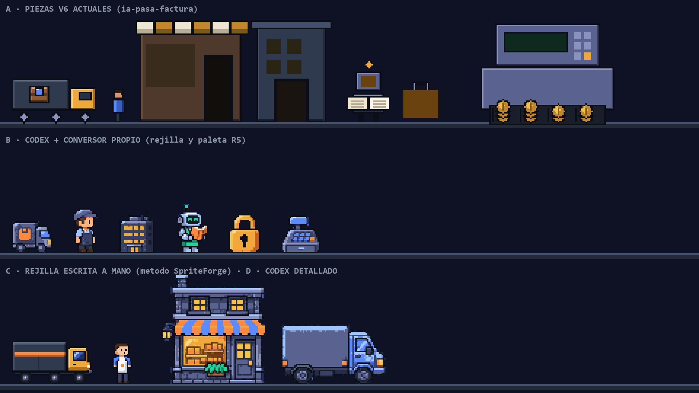

# Cómo crear los píxeles: biblioteca gigante, generador ya hecho o herramienta propia

Fecha: 2026-11-14. Estado: **investigación con una prueba pequeña; no cambia el estilo ni el motor y no hay nada
decidido**. Fuentes en [fuentes.json](fuentes.json).

**Pedido de Mario (2026-11-14):** diagnóstico a fondo de si conviene usar una aplicación para crear los píxeles de los
vídeos: una biblioteca gigante, un generador ya hecho o una herramienta nuestra, incluso averiguando por ingeniería
inversa cómo hacen los píxeles esas herramientas. Y si quedaría bien.

**Antecedentes:** la [propuesta del 2026-11-06](../biblioteca-pixel-2026-11-06/propuesta.md) y la
[investigación del 2026-11-13](../biblioteca-pixel-2026-11-13/informe.md), que Mario abandonó ese mismo día tras
[rehacer un short con packs de Kenney](../biblioteca-pixel-2026-11-13/prueba-v7.md). Aquello probó **bibliotecas ajenas**.
Un **generador** no se llegó a probar nunca (PixelLab se quedó en el papel) y una **herramienta propia** tampoco: eso es
lo nuevo de este informe.

## 1. Veredicto

| Vía | Veredicto | Por qué |
|---|---|---|
| Biblioteca gigante | **No** | Nada nuevo desde ayer: un set ajeno impone su vista, su luz y su píxel. Las grandes son cenitales o de 16×16 |
| Generador de pago (PixelLab, Retro Diffusion, SpriteForge) | **No hace falta ahora** | Lo mismo se consigue sin pagar (§2). Si algún día se paga, el que mejor encaja es Retro Diffusion |
| Herramienta propia | **Sí merece una prueba de verdad** | Codex genera la hoja en 1 minuto dentro de la suscripción y un conversor de 145 líneas la deja en nuestro formato y nuestra paleta |
| Ingeniería inversa | **No hay nada que destripar** | El método de SpriteForge es público y es el que ya usamos para MISTA; el posproceso de los de difusión es código abierto; el modelo entrenado no se puede replicar en este equipo |

**¿Quedaría bien?** Pieza a pieza, mejor que lo de ahora: más detalle y más carácter. Mezclado con las piezas v6
actuales, no: se nota otra mano. Tendría que hacerse un vídeo entero así (§4).

**Lo que no arregla:** las vueltas de crítica. El crítico casi nunca bloquea por la calidad del dibujo (§5).

## 2. La prueba de hoy

Hoja a 1920×1080, 4 px por píxel de arte, sobre el fondo nocturno. Hojas originales de Codex:
[primera](codex-hoja-1.jpg) y [segunda](codex-hoja-2.jpg).

| Fila | Qué es | Cómo se hizo |
|---|---|---|
| A | Piezas v6 de `ia-pasa-factura` (camión, paseante, tienda, foro, robot, candado, caja registradora) | Las funciones de `piezas-factura.js`, sueltas y con sus valores por defecto |
| B | 6 sprites de Codex | `codex exec` con una petición de hoja sobre fondo magenta → [convertir.py](../../../motor/piloto/piezas-generadas/convertir.py) → `sprite5` |
| C | Camión y tendero escritos como rejilla de letras | El método de SpriteForge hecho en casa: una letra por píxel con la paleta `R5` |
| D | Tienda y camión de Codex con más detalle | Igual que B, pidiendo píxel más pequeño |

| Medida | Resultado |
|---|---|
| Coste en dinero | 0 (suscripción de Codex) |
| Generar una hoja | Alrededor de 1 minuto (por la hora de los ficheros); 12.673 y 13.640 tokens |
| Convertir una hoja de 6 sprites | 2,0 s |
| Píxel falso detectado | 13,2-14,1 px en la primera hoja (1536×1024) y 9,4-10,8 px en la segunda (1774×887) |
| Tamaño real de los sprites | Fila B: de 17×31 a 28×22 píxeles de arte. Fila D: tienda 73×76 y camión 72×41 |
| Colores por sprite tras pasar a `R5` | De 10 a 33 |
| Integración | Entran como filas de letras y paleta, lo que ya pinta `sprite5` (`motor/estilo/v5/dibujo.js`). Sin PNG, sin cambios en el motor ni en el render |

**Lo que se ve:**
- **Codex dibuja mejor que nuestro código.** El tendero, el candado, la caja registradora y sobre todo la tienda de la
  fila D se entienden a la primera y tienen detalle (toldo, escaparate, farol, ladrillo). Las piezas v6 son cajas.
- **El píxel de Codex es falso:** no es entero, cambia de una hoja a otra y entre objetos de la misma hoja. Sin
  conversor no sirve. Con conversor queda en rejilla exacta y en nuestra paleta.
- **La conversión no sale limpia del todo:** quedan píxeles sueltos en el ladrillo, en las ruedas y en el edificio
  pequeño. Hace falta un repaso (otro intento, o corregir letras a mano).
- **La rejilla a mano (fila C) es la misma mano que la v6,** con más detalle que `camionF`. Es lo más coherente con lo
  publicado y lo menos vistoso.
- **El tamaño hay que pedirlo:** la primera hoja dio objetos de unos 25 píxeles de arte, pequeños para sujeto de
  estación. Con dos objetos por hoja salen de unos 72.

**Lo que no se pudo probar:** pasarle a Codex dos fotogramas del short A como referencia para que imitase el estilo v6.
El clasificador de permisos de Claude Code denegó la orden («Unsanctioned Communication», por enviar imágenes fuera) y no
se repitió. Es la prueba que diría si se puede acercar su mano a la nuestra.

## 3. Las tres vías

### 3.1 Biblioteca gigante
- Las más grandes: itch.io (53.641 packs gratuitos, licencia pack a pack), OpenGameArt (licencias mezcladas) y Kenney
  (más de 40.000 recursos, todos CC0) [f9]. El atlas de Krea, 1,4 millones de sprites de 16×16, ya se descartó.
- El problema no es el tamaño ni la licencia. Es lo que se aprendió ayer: **adaptarse a un set es adoptar su vista
  entera**. Nuestro mundo es lateral, nocturno y con contorno; lo abundante es cenital, de día y sin contorno.
- Los packs laterales de ciudad y oficina que aparecen son pequeños y cada uno de un autor distinto. No se ha
  encontrado ninguno grande, lateral, nocturno y CC0.

### 3.2 Generador ya hecho

| Herramienta | Cómo hace los píxeles | Precio | Nuestra paleta | Estilo por referencia | Licencia |
|---|---|---|---|---|---|
| **Retro Diffusion** [f2] | Modelo de difusión propio + reducción y cuantizado | 0,03-0,18 $ por imagen, sin suscripción | **Sí** (`input_palette`) | Sí, hasta 9 imágenes (Core y Pro) | No detallada en la guía de la API |
| **PixelLab** [f3, f4, f5] | Modelos de difusión propios | 0,007-0,017 $ por imagen básica; 0,08-0,15 $ en Pro; planes de 12-50 $ al mes según terceros | Sí en parte (Pixflux, Bitforge, inpaint) | Sí (Bitforge y Pro) | Tuyo y comercial; prohibido entrenar modelos con ello |
| **SpriteForge** [f1] | Un modelo Claude escribe la rejilla de letras | 0,03-1,62 $ por sprite | Sí (paleta bloqueada) | Sí, hasta 6 sprites | No aparece en la página |

- **Retro Diffusion es el que mejor encaja:** acepta nuestra paleta, genera a cualquier proporción hasta 512 px (un
  fondo de 480×270 entero), se paga por imagen y tiene MCP.
- **PixelLab es el más barato por llamada** y el único con los términos leídos y claros.
- **SpriteForge cobra por lo que ya hacemos:** su método es el nuestro (§3.3) y llega solo a 64 px.
- **Cuentas, a 40 piezas por vídeo y sin repetir intentos (aritmética mía):** Retro Diffusion 1,20-7,20 $; PixelLab
  básico 0,30-0,70 $; SpriteForge con Sonnet a 32 px, 16,40 $. El presupuesto son 10 $ al mes.
- **Animación:** los tres generan bucles (4-16 fotogramas en Retro Diffusion, hasta 8 en SpriteForge, hasta 40 en
  PixelLab). PixelLab avisa de que hay que generar varias veces y repasar.

### 3.3 Herramienta propia e ingeniería inversa
- **SpriteForge no esconde nada.** Lo dice su web: el modelo escribe el sprite como rejilla de letras con una clave de
  color, a su tamaño final [f1]. Es `sprite5`, con el que está hecho MISTA desde la v3. Lo que sí se puede copiar gratis
  son sus costumbres: paleta bloqueada, un sprite «héroe» como referencia de los demás, silueta primero y detalle
  después.
- **Los de difusión tienen dos partes:**
  - **El modelo.** Retro Diffusion se entrenó con pixel art licenciado [f8]. Replicarlo pide un conjunto de datos con
    permiso y una tarjeta gráfica; este equipo solo tiene la Intel integrada (comprobado con `Win32_VideoController`).
    Sus pesos no están publicados y los términos de PixelLab prohíben entrenar con lo que genera [f3]. **Descartado.**
  - **El posproceso.** Detectar el tamaño del píxel falso, reducir a la rejilla real y cuantizar a paleta. Es código
    abierto (pixeldetector, sd-palettize y K-Centroid de Astropulse; Pixel Snapper de Sprite Fusion) [f6, f7].
    **Replicado hoy** en [convertir.py](../../../motor/piloto/piezas-generadas/convertir.py) con Pillow y NumPy, que ya estaban instalados.
- **La herramienta propia sería:** un generador de imágenes cualquiera (hoy Codex, que ya se usa para las portadas) +
  el conversor + `sprite5`. Cambiar de generador más adelante no toca nada más.

## 4. ¿Quedaría bien?

- **Sí, si es todo el vídeo.** Las piezas generadas tienen más densidad de detalle y un sombreado más suave que las
  v6. Una tienda de la fila D al lado de un paseante de la fila A se lee como dos juegos distintos.
- **El motor no cambia:** mundo, cámara, paralaje, caja de diálogo, rótulos, cifras, lint y QA siguen igual. Sería un
  cambio de **cómo se dibujan las piezas**, no de estilo de vídeo.
- **Animar:** una pieza generada es una imagen fija. Se mueve con lo de
  [animar-un-set-ajeno.md](../biblioteca-pixel-2026-11-13/animar-un-set-ajeno.md): cámara, títere, estados y efectos
  por código encima (luces, ruedas, humo). Lo que explica un mecanismo (el grifo que se cierra, la balanza) sigue
  siendo dibujo por código.
- **MISTA y la caja** no se tocan.

## 5. Lo que esto no arregla

Defectos que marcó el crítico en la primera crítica de los dos vídeos en v6 (clasificación mía):

| Vídeo | Los 3 peores | De calidad del dibujo |
|---|---|---|
| `ia-pasa-factura`, shorts v1 | 6 (3 por short) | 1 a medias: la balanza, «líneas de 1 px sin sombreado», que además no se movía |
| `como-google-sabe-lo-que-quieres`, largo v2 | 3 | 0 |

- Lo que bloquea es **dirección de escena**: zooms que cortan una pieza, placas tapadas por el rótulo, tramos de 6 s
  casi quietos, una cifra que sale antes de tiempo.
- De los defectos menores, más o menos uno de cada cuatro sí es de dibujo: «móvil que parece una torre de ordenador»,
  «tendero diminuto», «rectángulo negro plano», «atril naranja sin rampa».
- Un generador mejora **cómo se ve** el vídeo. No reduce las 4,5 h de arreglos del vídeo de Google ni las cuatro
  vueltas de crítico de `ia-pasa-factura`.

## 6. Lo que no sé

- **Coherencia entre hojas:** las dos de hoy salieron con píxel y sombreado distintos. No sé si con referencias de
  estilo se igualan.
- **Estados de una misma pieza** (puerta abierta y cerrada, tienda encendida y apagada): no probado.
- **Qué diría el crítico** de una estación entera hecha así.
- **Cupo de Codex:** las dos hojas gastaron unos 13.000 tokens cada una; no sé cuántas admite al día.
- **Licencia de las imágenes de Codex:** no la he leído hoy (openai.com devuelve 403 al lector). Las portadas
  publicadas ya salen de ahí.
- **Tiempo por vídeo:** no medido. Generar es rápido; colocar, repasar y animar piezas más grandes puede costar lo
  mismo o más que dibujarlas.

## 7. Siguiente paso propuesto (necesita el sí de Mario)

1. **Permiso para enviar a Codex dos fotogramas del vídeo** como referencia de estilo, y ver si se acerca a la v6.
2. **Rehacer 2 estaciones del short A de `ia-pasa-factura`** (la tienda y el foro) con piezas generadas, con al menos
   un estado y un movimiento por pieza, en `.runtime/`, sin tocar lo publicado.
3. **Crítico sobre las dos versiones** y Mario mirándolas una al lado de la otra. Se miden minutos y tokens.

Si gana, entra como ADR y skill `estilo`. Si no, queda este documento.

**Decisiones de Mario:**
1. ¿Se hace la prueba de las 2 estaciones?
2. ¿Se permite enviar fotogramas del vídeo a Codex como referencia?
3. Si la prueba gusta: ¿todo el vídeo con piezas generadas, o solo el sujeto grande de cada estación?

## Verificación

- `codex exec --skip-git-repo-check -C <carpeta> -s workspace-write "<petición>"`: dos hojas, 1536×1024 y 1774×887,
  12.673 y 13.640 tokens (en `codex.log`).
- `python convertir.py hoja.png sprites.js 3 2 <nombres>`: 6 sprites en 2,0 s; la segunda hoja con `2 1`.
- `node capturar.mjs comparacion.png`: `errores: []`, captura a ×4 con el `chrome-headless-shell` del motor.
- Material de trabajo en `.runtime/investigacion-pixel/` (ignorado por git): hojas originales, `rejilla.js`,
  `comparar.html`, `capturar.mjs`. No se ha instalado nada ni se ha tocado `motor/`, `proyectos/` ni lo publicado.
- No se ha pasado el crítico visual ni se ha renderizado ninguna escena.

## Piloto (2026-11-14)

Hecho con Codex y con PixelLab sobre los primeros 26 s del short A: [piloto.md](piloto.md). Codex gana a la v6 en los
sujetos, con condiciones; PixelLab no sirve como base.
