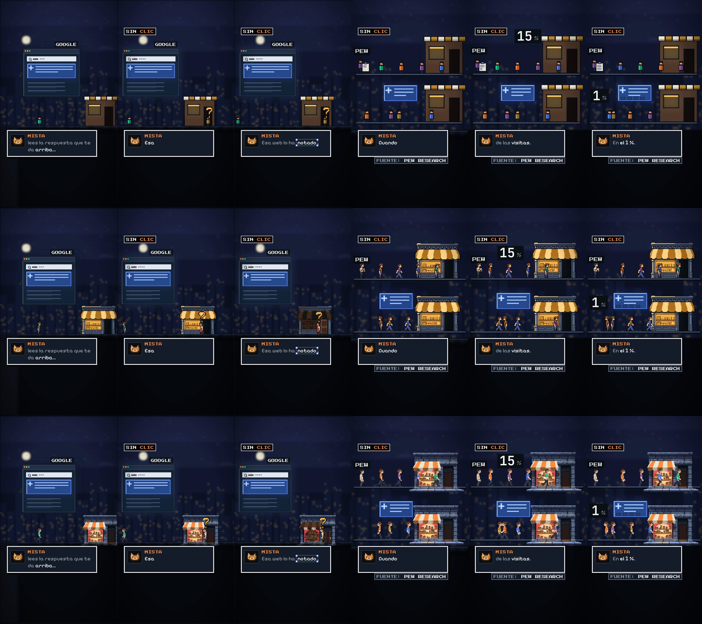

# Piloto: piezas de Codex y de PixelLab frente a la v6

Fecha: 2026-11-14. Rama `prueba/piezas-generadas`, sin commits. Interno: no se publica. Sigue a [informe.md](informe.md).

**Pedido de Mario:** un piloto pequeño con una herramienta externa (PixelLab, con su cuenta de prueba) y con la vía
de Codex más rejilla escrita a mano, para ver si quedaría bien y cómo cambia la forma de animar. Decidió: las dos cosas
de la fila de abajo de la comparación (piezas grandes de Codex y partes móviles a mano), enviar fotogramas del vídeo
como referencia de estilo y una pasada del crítico.

## 1. Veredicto

- **Codex sí, con condiciones.** Es la versión que mejor se entiende sin leer, la que mejor encaja con el resto de la
  v6 y la que mejor se lee a 360 px, según el crítico. Mejora a la v6 en los sujetos: tiendas y personas.
- **PixelLab no, como base.** Se reconoce todo, pero mete ruido (fachada de piedra, escaparate lleno) y se nota otra
  mano. Lo único que aporta y Codex no da es el **ciclo de andar de 6 fotogramas**.
- **Condiciones para usar Codex** (crítico y medidas):
  1. Todas las estaciones de un vídeo generadas, o ninguna: mezclarlas con piezas por código se nota.
  2. Cuidar la lectura de lo pequeño: la «?» se pierde sobre el toldo y el portapapeles del observador no se ve.
  3. Cambiar `docs/estilo.md` («Fuentes de arte: dibujo propio por código») con un ADR, si Mario lo aprueba.

## 2. Qué se hizo

Los primeros 26,2 s del short A de `ia-pasa-factura` (estaciones 0 y 1: la tienda y las dos calles de Pew) en tres
versiones, con la misma voz, cámara, rótulos, cifras y caja. Solo cambian la tienda, los paseantes, el tendero y el
observador.

| | Codex | PixelLab |
|---|---|---|
| Cómo se generó | `codex exec` con dos fotogramas del short como referencia, hoja sobre magenta → `convertir.py` (rejilla, 12-16 tonos agrupados y paleta `R5`) | Tienda con Pixflux (paleta forzada); personajes con su flujo de personajes (`create-character-with-4-directions`) y la plantilla `walking` |
| Llamadas | 4 (2 de tienda y 2 de personas; se usó una de cada) | 14 (1 tienda y 3 personajes y 1 animación útiles) |
| Coste | 0 $; unos 70.000 tokens de Codex | 0 $; 13 de las 40 generaciones de prueba (a precio de pago, menos de 0,50 $ según su web) |
| Tiempo por llamada | ~1 min | 13-37 s |
| Piezas | Tienda 86×67; personas de 28 px (forzando el píxel al convertir) | Tienda 102×73 con su acera; personas de 33 px |
| Andar | 2 poses de Codex (quieta y a mitad de paso) | 6 fotogramas generados |
| Hecho a mano | La hoja de la puerta que se cierra; las coordenadas del hueco, el escaparate y la tablilla | El hueco de la puerta abierta; las mismas coordenadas; desplazar la tienda 10 px en el zoom |
| Lint estricto | 0 errores (tras bajar la cifra «15 %», que caía bajo el rótulo en el zoom) | 0 errores |
| Render del tramo | 48 s (847 capturas) | 56 s |
| Tramos casi quietos ≥ 1,5 s | 0 | 0 (la v6 publicada, también 0) |

Escenas en `motor/calibracion/piezas-generadas/` (`short-a-codex.html`, `short-a-pixellab.html`, `short-a-piloto.js`,
`piezas-gen.js` y las piezas convertidas). Herramientas en `motor/piloto/piezas-generadas/` (`convertir.py`,
`pixellab.mjs`). Vídeos y hojas en `.runtime/piloto-piezas/` (fuera de git): `comparacion.mp4` con las tres versiones
lado a lado y el audio publicado.

## 3. Cómo cambia la forma de animar (lo probado)

- **Estados por paleta.** La tienda se apaga cambiando sus colores ámbar por marrones oscuros: sin regenerar nada.
  Igual las camisas: cada paseante, otro color sobre la misma pieza.
- **Ciclos.** El paseante anda con fotograma = f(t): 2 poses en Codex, 6 en PixelLab. Se voltea para ir hacia el otro
  lado.
- **Lo que la pieza no trae, a mano como rejilla:** la hoja de la puerta que entra al cerrar (Codex) o el hueco oscuro
  de la puerta abierta (PixelLab), con la paleta del canal.
- **La historia gana acciones:** el tendero sale a la puerta, mira la calle vacía y la tienda se apaga y cierra tras él.
  El crítico lo destaca: «cuentan "la web lo ha notado" sin texto».

## 4. Lo aprendido de cada herramienta

**Codex**
- **No mantiene la escala entre hojas.** La primera tienda tenía la puerta más baja que los personajes. Al pedir
  personajes «a la escala de la tienda», los dibujó más pequeños en la imagen pero con píxel más fino: convertidos
  salían más altos (41 frente a 37). Se arregla forzando un píxel más grueso al convertir (`--pixel`), que reduce de
  37 a 28 px y aguanta bien.
- **Sí repite el personaje entre poses** (mismo pelo, ropa y tamaño), aunque a veces con otro marrón de pelo: se iguala
  por paleta.
- **Agrupar los colores antes de pasarlos a la paleta** quita el moteado de superficies planas (toldo, escaparate).
- **Mezclas con el fondo:** el borde del contorno con el magenta da morados que acaban en azul; el conversor los
  descarta.

**PixelLab**
- **Bitforge con referencia de estilo copia la referencia** casi literalmente (salieron hasta las personas del
  fotograma) y no quitó el fondo. Además exige que la referencia mida lo mismo que la imagen pedida.
- **Pixflux** da píxel real y buena pinta, pero tiende a llenar el lienzo (fachada a sangre con acera); hay que pedir
  «aislado, edificio entero» para obtener una pieza suelta. La puerta salió cerrada y con un letrero de letras
  inventadas.
- **Para personas no sirve Pixflux** (en 40 px salieron sin contorno y mirando al lado contrario; en 32 px, recortadas
  de cintura para arriba). Su **flujo de personajes** sí: figuras limpias y su animación de andar en una llamada.
- **La escala tampoco cuadra:** personas de 33 px frente a una puerta de 28.
- **La API usa las generaciones de prueba** (1 por imagen o personaje). Las animaciones responden con una lista de
  trabajos (`background_job_ids`) y los fotogramas se bajan en el zip del personaje.

## 5. Crítica (Opus, una pasada sobre las hojas a 2 fps y seis momentos a 360 px)

Resumen; la tabla de defectos completa sigue.

| Versión | Los 3 peores | Bloquea |
|---|---|---|
| v6 | La estación de la tienda no se entiende sin leer (paseante de 2-3 px a 360, tienda como caja); las personas son pastillas de dos colores y no se ve quién entra; el «15 %» pegado al tejado | No, pero «floja como base» |
| Codex | La «?» amarilla se pierde sobre el toldo a 360; el observador no se distingue de los paseantes (el portapapeles no se ve); algo de mezcla de densidades con la ventana de Google y la tarjeta de IA | No |
| PixelLab | Ruido: piedra con textura y escaparate lleno, que tapan quién entra; «otra mano» (parece de un pack de RPG) y un acento rojo de más; la tienda cerrada se lee como otra textura | No para publicar; sí para usarlo como base |

**Comunes a las tres, no dependen de las piezas** (la v6 publicada también los tiene):
- [12,7-21 s] «PEW» y la cifra a la vez en pantalla: el estilo permite uno de los dos. El crítico lo da por bloqueante.
- [0-2 s] El título «SIN CLIC» dura menos de 2 s.
- [18,5 s] El «8 %» sustituye al «15 %» en lugar de convivir con él.
- [7-24 s] La puerta de la tienda de abajo entra en la franja derecha (x > 237).
- [8-15,5 s] Unos 7 s sin nada nuevo salvo el zoom y la gente; se nota menos con figuras que andan.

**Conservar:** el toldo de Codex y su versión cerrada; las personas con silueta y paso de Codex y PixelLab; el
portapapeles blanco de la v6 (la mejor forma de señalar al observador).

**Lo que el crítico no pudo comprobar:** la rejilla a 1:1 (las hojas están reducidas) y el andar de 6 fotogramas (a
2 fps no se ve). La rejilla está garantizada por construcción: las piezas se pintan con `sprite5`, un rectángulo por
píxel de arte en unidades enteras, igual que el resto de la v6. El andar está en `comparacion.mp4`.

## 6. Coste por vídeo (2026-11-15, pedido de Mario antes de decidir)

**Datos de partida (medidos o leídos):**
- **Codex:** plan **Plus** (`plan_type` en los registros de `~/.codex/sessions`). Las 6 llamadas de imagen del piloto no
  movieron los contadores de la CLI: ventana de 5 h en 5 % y semanal en 1 % de principio a fin. La CLI da enteros, así
  que solo se sabe que **6 imágenes gastaron menos de un 1-2 % de la semana**. No sé si las imágenes tienen además un
  tope propio aparte del de Codex.
- **PixelLab** (pixellab.ai, sección de precios, 2026-11-15):
  - Gratis: 40 generaciones rápidas y después **5 lentas al día (acumula hasta 20)**, con API, MCP y uso comercial.
  - Tier 1: 12 $/mes, 2.000 generaciones; Tier 2: 24 $, 5.000; Tier 3: 50 $, 10.000. Anual, ~25 % menos.
  - «Algunas herramientas gastan más de una generación por imagen». En el piloto: 1 por imagen, 1 por personaje con sus
    4 direcciones y 1 por la animación de andar en una dirección.
  - También hay pago por uso en dólares (0,007-0,04 $ por llamada básica, según su página de la API); no sé cuál es la
    compra mínima de créditos.
  - Quedan **27 de las 40** de prueba en la cuenta del piloto.
- **Piezas nuevas por vídeo:** `ia-pasa-factura` (2 shorts) dibujó unas 30 nuevas; `como-google` (largo y 3 shorts),
  73. Tipos de persona por vídeo: 3-8 (el resto son la misma figura con otra camisa).
- **Intentos:** en el piloto, 2 llamadas por pieza útil en Codex y casi 3 en PixelLab (con aprendizaje). Uso 2 y 2,5.

**Cuentas (estimación mía, no medida):**

| Vía | 2 shorts (~30 piezas, ~4 personas) | Largo + 3 shorts (~73 piezas, ~7 personas) | Dinero extra |
|---|---|---|---|
| **Solo Codex** (3 piezas por hoja) | ~20 llamadas: **≤ 7 % de una semana** de Plus | ~50 llamadas: **≤ 17 % de una semana** | 0 $ |
| **Solo PixelLab** (1 pieza por llamada + andar) | ~85 generaciones | ~200 generaciones | Gratis no llega (5 al día); Tier 1, 12 $/mes (o ~9 $/mes en anual); por uso, ~1-8 $ por vídeo |
| **Juntos:** Codex para edificios y objetos, PixelLab solo personas con su andar | Codex ~15 llamadas (≤ 5 %) + PixelLab ~20 generaciones | Codex ~40 (≤ 13 %) + PixelLab ~35 | **0 $** con la cuenta gratuita: 20 acumuladas cubren un par de shorts; un largo pide generarlas con una semana de margen, o tirar de las 27 que quedan |

- **Las personas se reutilizan:** una vez hechos el paseante, el tendero o el investigador con su andar, valen para los
  vídeos siguientes con otra camisa por paleta. El gasto de PixelLab baja con cada vídeo.
- **El presupuesto es de 10 $/mes:** el Tier 1 mensual (12 $) se pasa; el anual (~9 $/mes, un año de compromiso) cabe.
  Cualquier pago necesita el sí de Mario.
- **Lo que no se ha probado:** personas de PixelLab junto a edificios de Codex en la misma estación. El crítico solo
  vio cada herramienta por separado, y la mezcla de manos es justo su advertencia principal.

## 7. Decisiones de Mario

1. ¿Se adopta Codex + conversor para los sujetos (tiendas, personas, objetos grandes) en el siguiente vídeo, con un
   ADR y el cambio en `docs/estilo.md`?
2. Si sí: ¿todas las estaciones generadas (recomendado por el crítico) o solo el sujeto grande de cada una?
3. ¿Se queda algo de PixelLab (el andar de 6 fotogramas) o se descarta del todo?
4. Los defectos comunes de §5 están también en el short publicado: ¿se tocan o se deja estar?
5. ¿Se confirma la rama en un commit para conservar el piloto, o se queda sin confirmar?

## Verificación

- `node motor/revisar.mjs motor/calibracion/piezas-generadas/short-a-{codex,pixellab}.html 270 480 26.2 0.05 <capturas> --estricto`:
  0 errores en las dos.
- `node motor/render.mjs … --hasta 26.2`: 847 capturas, 48 s y 56 s.
- `ffmpeg … freezedetect=n=0.001:d=1.5`: 0 tramos en las tres versiones.
- `ffprobe .runtime/piloto-piezas/comparacion.mp4`: 1620×960, 60 fps, 26,2 s, con audio.
- `node motor/piloto/piezas-generadas/pixellab.mjs saldo`: 27 de 40 generaciones de prueba restantes, 0 $ de créditos.
- `npm test` (en `motor/`): 35 de 35.
- La clave de PixelLab no está en ningún fichero del repo: se pasó como variable de entorno en cada orden (los permisos
  no dejan escribir en `.runtime/claves/`).
